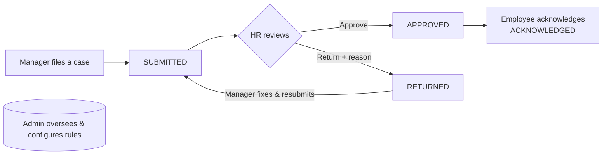

# Compliance Tracker

A **progressive-discipline / corrective-action tracker** for HR teams. When an employee breaks a rule, the outcome shouldn't depend on who's handling it — every case follows the same rules-driven process, from first report to closure, with a complete, defensible audit trail.

Built as a full-stack app with **four real roles**, a **rules engine**, and an end-to-end **approval workflow**.

> **Live demo:** _add your deployed URL here_
> **Demo logins** (password `Demo1234!` for all):
> | Role | Email |
> |---|---|
> | Manager | `manager@demo.com` |
> | HR | `hr@demo.com` |
> | Employee | `employee@demo.com` |
> | Admin | `admin@demo.com` |

---

## What it does

A manager files an incident against an employee. The **rules engine** counts that employee's prior offenses for that violation and **automatically decides the mandated action** (verbal warning → written warning → suspension → dismissal) — so discipline is consistent, not arbitrary. HR reviews and approves (or returns with a reason); the employee acknowledges; every step is recorded.

### The workflow



Every transition is written to an append-only audit trail (`Submitted → Approved by HR → Acknowledged by employee`, with who and when).

---

## Features by role

**Manager**
- Overview dashboard (KPIs, recent cases, "employees to watch", cases by violation)
- Employees CRUD (name, designation, optional login email)
- Create incident — with a **live offense preview** (shows the offense # + mandated action *before* you submit)
- Cases: view / edit / delete / **resubmit** returned cases, plus each case's audit timeline
- Rule book (data-driven, per-violation ladders)

**HR**
- Overview dashboard (pending / approved / returned, by violation, most-active managers)
- Review queue with **Pending / Reviewed** tabs
- **Approve** or **Return with a reason** (logged and shown to the manager)
- Per-case audit history

**Employee**
- Overview of their own record + an acknowledgment prompt
- "My cases" — see approved cases about them, full details + history, and **acknowledge** each

**Admin**
- Org-wide overview (all cases, by manager & violation, people by role)
- Users roster
- **Manage rules** — add/delete the escalation ladders the engine uses

---

## Tech stack

| Layer | Tech |
|---|---|
| Frontend | React + Vite + TypeScript, Redux Toolkit, React Router, Tailwind CSS, lucide-react |
| Backend | Node.js + Express, **raw SQL** via `pg` (no ORM) |
| Database | PostgreSQL (hosted on Neon) |
| Auth | Roll-your-own: bcrypt password hashing, DB-backed sessions, httpOnly cookies |
| Email | Resend (password-reset links) |

## Design highlights

- **Roll-your-own auth** — bcrypt + opaque session tokens stored in an `httpOnly`, `SameSite=Lax` cookie; a `requireAuth` middleware attaches the user to every protected request.
- **Role-based access control (RBAC)** — the same endpoints return role-aware data (a manager sees their team; HR sees all pending; an employee sees only cases about them), and the UI's landing page + navigation adapt per role.
- **Rules engine** — offense count + a per-violation ladder decide the action; the same logic powers the live preview and the saved case.
- **Audit integrity** — every state change is logged to `case_events`; approved/closed cases are locked from editing or deletion (front and back).
- **Parameterized SQL** everywhere (no string-built queries).

---

## Running locally

**Prerequisites:** Node.js 18+, a PostgreSQL database (a free [Neon](https://neon.tech) project works well).

### 1. Database
Create the schema and reference data:
```bash
psql "<YOUR_DATABASE_URL>" -f db/schema.sql
psql "<YOUR_DATABASE_URL>" -f db/seed.sql
```

### 2. Backend
```bash
cd backend
npm install
# create backend/.env :
#   DATABASE_URL=postgres://...        (your Neon connection string)
#   RESEND_API_KEY=re_...              (optional, for password-reset emails)
npm run dev            # http://localhost:4000
```

### 3. Frontend
```bash
cd frontend
npm install
npm run dev            # http://localhost:5173  (proxies /api -> :4000)
```

Open **http://localhost:5173**, sign up (or use the demo logins above), and go.

---

## Project structure

```
backend/        Express API (server.js), pg pool (db.js)
frontend/src/
  pages/        role screens (Overview, Employees, CreateIncident, Cases,
                RuleBook, HRReview, HROverview, MyCases, EmployeeOverview,
                AdminOverview, AdminUsers, AdminRules, auth pages)
  components/   DashboardLayout, Dropdown, SubmitButton, ProtectedRoute, Loader
  store/        Redux Toolkit auth slice + store
db/             schema.sql, seed.sql
```

---

## Notes

- Roles are self-selected at signup for demo purposes; in production, roles would be assigned by an admin.
- The employee↔login link is by matching email; a future iteration could unify people into a single `users` table with a `reports_to` hierarchy.
